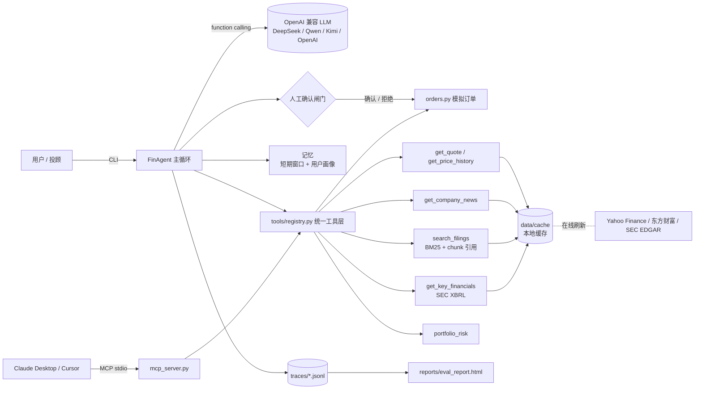

# fin-advisor-agent：美股投研 Agent（MCP + RAG + 人工确认 + 评测）

一个面向个人投资者和投顾的美股投研 Agent 原型。覆盖 NVDA、MSFT、AAPL、TSLA、AMZN 五家公司，QQQ 作为基准。

*English: A prototype research agent for US equities. It exposes market data, SEC filing search (BM25 RAG with citations), XBRL financials, portfolio risk and a simulated order tool through one tool layer, served both as an MCP server and to an OpenAI-compatible function-calling agent. Orders require explicit human confirmation. Includes pytest, a retrieval eval and an agent-level eval harness.*

## 能做什么

| 能力 | 实现 |
|---|---|
| 工具调用 | 7 个工具：行情、历史价格、新闻、财报检索、XBRL 财务数据、组合风险、模拟下单 |
| MCP | 官方 `mcp` Python SDK，stdio 传输，可接入 Claude Desktop / Cursor |
| RAG | 10 份最新 10-K / 10-Q 按 Part / Item 切分为 1,820 个 chunk，BM25 检索，回答必须标注 `[chunk_id]` |
| Agent | OpenAI 兼容的 function calling 循环（DeepSeek / Qwen / Kimi / OpenAI 通过环境变量切换），先说明计划再调用工具 |
| 记忆 | 短期记忆（按轮次滑动窗口）+ 用户画像（持仓、风险偏好，持久化） |
| 人工确认 | `draft_order` 只生成待确认的模拟订单，确认 token 不返回给模型，只能由人确认 |
| 可观测性 | 每次运行写一行 JSONL 轨迹：步骤、工具参数、耗时、token、估算成本 |
| 评测 | pytest 41 项；RAG 检索评测 49 题；Agent 评测 32 个任务；badcase 自动分类；静态 HTML 报告 |

本项目不连接任何券商，不执行任何真实交易，输出不构成投资建议。

## 架构



## 数据源

开发时在沙箱中逐一测试过可达性（2026-11-05）：

| 数据源 | 状态 | 用途 |
|---|---|---|
| SEC EDGAR submissions / Archives | 可用 | 下载最新 10-K、10-Q 原文 |
| SEC XBRL companyfacts | 可用 | 结构化财务数据 |
| Yahoo Finance chart API | 可用 | 日线行情（主源） |
| Yahoo Finance RSS | 可用 | 公司新闻 |
| 东方财富 push2his | http 可用，https 超时 | 日线行情（备用源） |
| Stooq | 不可用，返回 JS 验证页 | 未使用 |

所有数据缓存在 `data/cache/`（约 3.3 MB，已随仓库提交），默认离线模式只读缓存，演示和评测结果可复现。缓存快照：行情截至 2026-11-04 收盘，财报为各公司截至 2026-11-05 最新一期 10-K 和 10-Q。

## 快速开始

```bash
python -m venv .venv && source .venv/bin/activate
pip install -r requirements.txt

# 1. 不需要 API key：演示工具层
python -m finagent.cli tools

# 2. 跑测试和检索评测
python -m pytest -q
python eval/run_rag_eval.py

# 3. 需要 API key：对话
export BASE_URL=https://api.deepseek.com      # Qwen: https://dashscope.aliyuncs.com/compatible-mode/v1
export API_KEY=sk-...                          # Kimi: https://api.moonshot.cn/v1
export MODEL=deepseek-flash
python -m finagent.cli chat
python -m finagent.cli ask "英伟达最大客户占营收多少？请引用财报"

# 4. Agent 级评测 + 生成 HTML 报告
python eval/agent_eval.py
python scripts/build_report.py                 # 输出 reports/eval_report.html

# 可选：刷新数据（会联网，SEC 要求 User-Agent 带联系方式）
export SEC_USER_AGENT="your-name your@email.com"
FINAGENT_OFFLINE=0 python scripts/fetch_data.py
python scripts/build_index.py
```

成本估算：内置 DeepSeek 两个模型的官方价格（来源见 `finagent/agent/cost.py`）。其他模型请设置 `FINAGENT_PRICE_INPUT_PER_M`、`FINAGENT_PRICE_OUTPUT_PER_M`（美元/百万 tokens），未设置时只记录 token，不估算金额。

## 接入 Claude Desktop / Cursor

先用 `python scripts/mcp_smoke_test.py` 确认 server 正常（会列出 7 个工具并逐个调用）。

Claude Desktop：编辑 `claude_desktop_config.json`（macOS 位于 `~/Library/Application Support/Claude/`，Windows 位于 `%APPDATA%\Claude\`）：

```json
{
  "mcpServers": {
    "fin-advisor": {
      "command": "/绝对路径/fin-advisor-agent/.venv/bin/python",
      "args": ["-m", "finagent.mcp_server"],
      "env": { "PYTHONPATH": "/绝对路径/fin-advisor-agent" }
    }
  }
}
```

Cursor：在项目根目录或 `~/.cursor/` 下创建 `mcp.json`，内容同上。

通过 MCP 下单时，模型只能拿到待确认订单。确认需要用户在本地终端执行：

```bash
python -m finagent.orders list
python -m finagent.orders confirm SIM-XXXXXXXX   # 需要手动输入订单号才会确认
```

## 当前评测结果

全部数字来自实际运行，详见 [docs/eval-report.md](docs/eval-report.md)。

| 项目 | 结果 |
|---|---|
| pytest | 41 passed, 0 failed |
| RAG 检索（49 题，按 ticker 过滤） | Recall@5 = 83.7%，Recall@10 = 89.8%，MRR@10 = 0.656 |
| RAG 检索（49 题，全库） | Recall@5 = 79.6%，Recall@10 = 85.7%，MRR@10 = 0.548 |
| MCP stdio 冒烟测试 | 7/7 工具调用成功 |
| Agent 级评测（32 任务） | 待运行，需要 API key |

## 目录

```
finagent/
  config.py            路径、标的池、请求头
  data_sources.py      Yahoo / 东方财富 / SEC 适配与缓存
  tools/               market.py filings.py risk.py orders.py registry.py
  rag/                 chunker.py（按 Item 切分）retriever.py（BM25）
  agent/               loop.py llm.py memory.py trace.py cost.py
  mcp_server.py        MCP stdio server
  orders.py            人工确认 CLI
  cli.py               演示入口
eval/                  rag_questions.jsonl agent_tasks.jsonl run_rag_eval.py agent_eval.py results/
scripts/               fetch_data.py build_index.py mcp_smoke_test.py build_report.py demo_scripted_trace.py
tests/                 41 项测试
docs/                  PRD.md eval-report.md
reports/               eval_report.html
data/cache/            离线数据快照
```

## License

MIT
